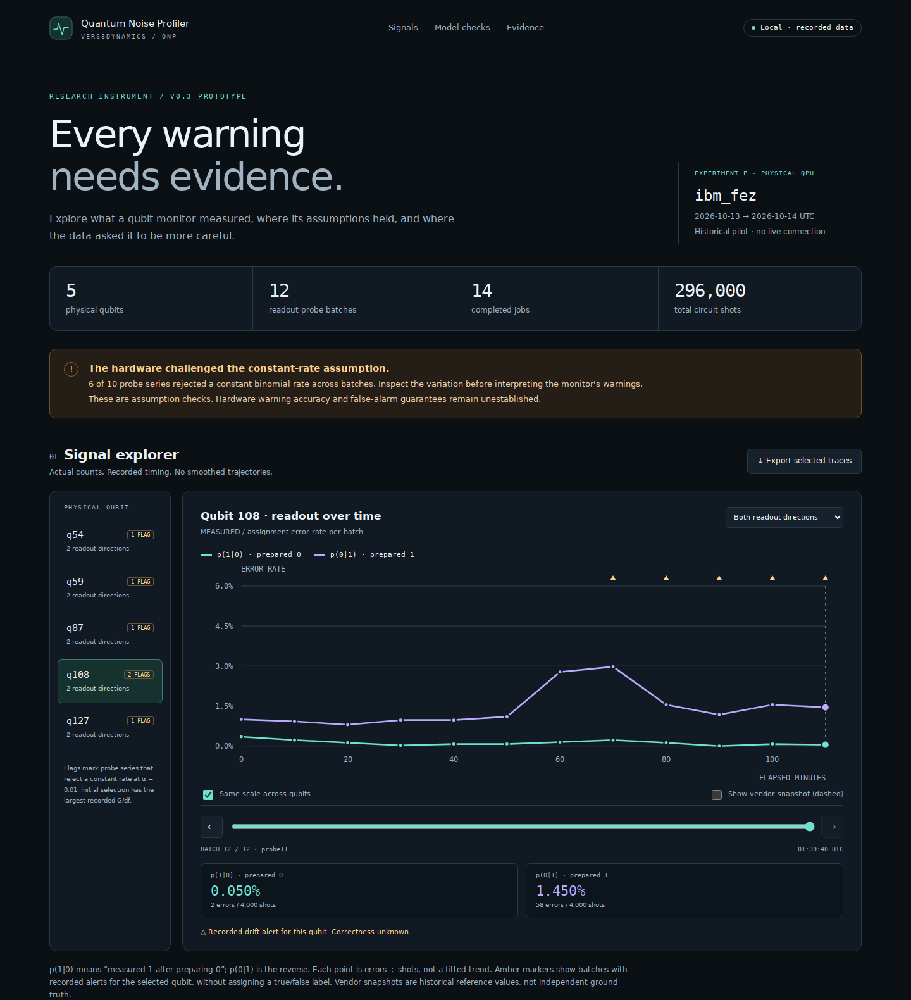
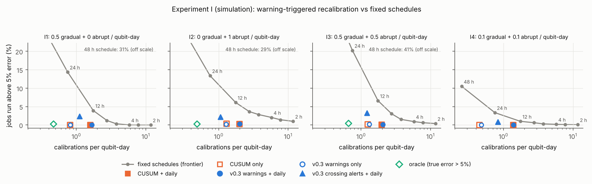

# Quantum Noise Profiler

### Every warning needs evidence.

**An open research instrument for tracking qubit noise, inspecting uncertainty,
and knowing when the data cannot support an answer.**

Quantum Noise Profiler (`qnp`) separates vendor calibration records, estimates
from ordinary workloads, and dedicated measurements. Its monitoring engine
reports the evidence behind each warning. Its offline explorer lets you inspect
the first physical-QPU experiment, down to the recorded shot counts.

[Explore the evidence](#explore-the-real-hardware-data) · [Use the Python API](#use-the-monitor) · [Results and limits](#what-the-evidence-says) · [Reproduce](#reproduce-and-verify)

> **v0.3 research prototype · hardware warning accuracy is not established.**
> The simulation study passed 40/40 preregistered criteria. The first real-device
> pilot challenged the constant-rate assumption in 6/10 readout series.
> Both findings are part of the result.



## Explore the real hardware data

No IBM account, API key, quantum SDK or web server is needed. From a local clone:

```bash
git clone https://github.com/topherchris420/quantum-noise-profiler.git
cd quantum-noise-profiler
python -m pip install -e .
python -m qnp report
```

Open **`qnp-evidence.html`** in your browser. The report is self-contained and
works offline. You can also download the [generated HTML snapshot](docs/evidence-explorer.html)
and open it locally; GitHub's file viewer does not execute HTML.

The explorer lets you:

- **Inspect a qubit:** compare both readout directions, step through 12 recorded
  batches, and see the underlying errors and shots. A shared vertical scale
  makes comparisons between qubits honest.
- **Interpret a warning:** locate recorded alerts without treating them as
  verified hardware failures. Historical vendor values are optional references.
- **See where the model abstained:** inspect every T1 fit, conditional interval,
  withheld estimate and reason code.
- **Audit the evidence:** review the original assumption checks, expand every
  simulation criterion, and export the plotted traces as CSV or the evidence
  bundle as JSON.

Before rendering, the exporter checks the displayed run entries and raw files
against `MANIFEST.sha256`, then reproduces probe rates and homogeneity statistics
from raw counts. It refuses missing or mismatched evidence and excludes fake,
rehearsal and smoke runs from hardware results. T1, alert and simulation summaries
are shown as recorded; the separate verifier recomputes those too.

```bash
python -m qnp report --results-dir results --output my-report.html
python -m qnp demo       # deterministic synthetic example; prints strict JSON
qnp --help              # equivalent installed command
```

Reports never overwrite `results/`. Use `--force` to replace an existing HTML
export. [Explorer guide and verification scope →](docs/EVIDENCE_EXPLORER.md)

## What the evidence says

### A physical device challenged the model

**IBM `ibm_fez` · October 13–14, 2026 UTC · 5 qubits · 14 jobs · 296,000 shots.**
Experiment P was a preregistered two-hour assumption check, not a test of whether
alerts predict real hardware failures.

| Registered check | Recorded result | Interpretation |
|---|---|---|
| **P.C1:** a constant binomial error rate across 12 probe batches | 6/10 series reject; criterion failed | The constant-rate model did not describe these series adequately |
| **P.C2:** interleaved references detect readout drift within T1 sweeps | 0/10 sweeps reject; criterion passed | No within-job drift detected by this check; stability is not proved |
| T1 model checks | 7 estimates reported; 3 withheld | A number is withheld when coverage or fit diagnostics cannot support it |
| Recorded drift alerts | Five, on qubit 108 | Their true/false status is unknown without independent reference data |

On qubit 108, `p(0|1)` rose from about 1% to nearly 3%, then partially recovered.
The explorer makes that excursion visible without assigning it an unverified
physical cause. Batch independence, generality across devices, and operational
value on hardware remain untested.

[Hardware addendum](docs/report/HARDWARE_ADDENDUM.md) · [Complete v0.3 results](results/V03_SUMMARY.md) · [Proposed independent follow-up](experiments/P04_FOLLOWUP_PLAN.md)

### Two simulation studies, including their failures

| Study | Result | What it establishes |
|---|---|---|
| **v0.3 follow-up** | 40/40 preregistered criteria passed | Improvements under the specified simulated conditions |
| **v0.2 study** | 53/62 preregistered checks passed | Useful improvements and explicit remaining failure modes |
| **Physical pilot** | P.C1 failed; P.C2 passed | Evidence about assumptions on one device over two hours |

Selected v0.3 simulation results:

| Question | v0.2 design | v0.3 design |
|---|---:|---:|
| Runs with a false alert after adding a 2 µs idle to an unchanged device | 1.00 | 0.02 |
| Runs with a false alert after adding two-qubit gates | 0.43 | 0.05 |
| T1 reported confidently wrong under slow readout drift (D11 conditions) | 0.255 | 0.005 |
| T1 reported confidently wrong under linear readout drift of ±1.5% | 0.370 | 0.000 |

The false-alert rows use the **empirically calibrated** configuration, with 100
simulated runs per scenario. T1 rows use 200 fits per scenario and design.
These are observed simulation outcomes, not hardware guarantees.

In the closed-loop simulation, warnings plus daily calibration reduced jobs
run above 5% readout error from 13–20% to at most 0.31%. This uses illustrative
degradation rates and assumes recalibration on demand. Warnings did not
consistently reduce calibration overhead, and a calibrated CUSUM baseline
performed comparably. Cloud-user interventions such as remapping qubits have
not been validated.



<details>
<summary>Earlier results and unresolved limitations</summary>

The v0.2 anytime-valid configuration raised an alert in at most 1% of stable
sessions across five simulated conditions. That is an observed rate, **not a
universal 1% guarantee**. The declared session budget is `alpha_session = 0.10`,
and each channel has its own null assumptions.

The 253-minute median warning lead came from a separate **calibrated**
configuration with empirical error control. At matched false-alert rates, it
outperformed a Shewhart baseline (223 minutes) and CUSUM (213 minutes) in that
scenario. Forecast coverage was measured across correlated forecasts within
runs, not independent hardware trials.

Failures remain instructive:

- A 10% step was detected within five batches in only 0.09 of runs, below the
  original 0.80 target. CUSUM remained better at detecting the smallest steps
  within 24 batches (0.64 versus 0.52).
- Stationary 10% fluctuations triggered alerts in about half of runs in an
  exploratory condition. The hardware pilot reinforces the need to model
  excess variation before deployment.
- Simulations omit leakage, coherent errors, crosstalk, 1/f dephasing and
  correlated multi-qubit errors. The tested monitoring families were small;
  the union-bound budget becomes conservative at scale.
- The original v0.1 engine raised false alarms in 62% of stable simulated
  sessions and reported confident but wrong T1 values under misspecification.
  It remains available as a frozen comparator.

[Full v0.2 results](results/V02_SUMMARY.md) · [v0.1 audit](docs/V01_AUDIT.md) · [E2 correction](results/E2_CORRECTION.md)

</details>

## Use the monitor

The core install requires Python 3.10+, NumPy and SciPy. Quantum providers are
optional extras: `.[qiskit]`, `.[cirq]`, `.[ibm]`, or `.[dev]` for the complete
development environment.

```python
import json
from datetime import datetime, timezone

from qnp import DriftConfig, ErrorBudget, Profiler
from qnp.measured import estimate_readout

# Declare the monitoring family before inspecting data.
profiler = Profiler(config=DriftConfig(
    budget=ErrorBudget(n_qubits=5, n_metrics=1, n_provenances=1)
))

# Illustrative input: replace with counts and acquisition timestamps from your probes.
profiler.add(estimate_readout(
    qubit=0, prepared=0, errors=42, shots=4000,
    timestamp=datetime(2026, 10, 1, tzinfo=timezone.utc),
    source="illustrative-counts",
))

# Includes evidence, withheld forecasts, notices, latest estimates and budget status.
session = profiler.session_report()
print(json.dumps(session, indent=2, allow_nan=False))
```

A single batch is not enough to establish a drift trend. Missing evidence is
reported explicitly. `profiler.check()` returns alerts, `profiler.report()`
returns per-group diagnostics, and `profiler.snapshot()` includes withheld
estimates as well as successful ones.

| Capability | Behavior |
|---|---|
| **Provenance** | Keeps OBSERVED vendor values, INFERRED workload estimates and MEASURED probes in separate series |
| **Sequential monitoring** | Reports channel-specific evidence, thresholds and guarantee types under an explicit session budget |
| **Meaningful change** | Drift warnings require evidence, an effect-size gate and persistence |
| **Workload-aware thresholds** | Absolute readout thresholds apply to readout probes; workload-dependent effective flip rates get relative-change monitoring by default |
| **Model checks** | T1/T2 estimates are withheld when delay coverage or fit diagnostics fail |
| **Forecast abstention** | Gives machine-readable reasons for insufficient history, unsupported trends, misspecification and unsupported horizons |
| **Session export** | `session_report()` produces strict JSON, preserves missing evidence and exposes budget validity |

**Budget status is not hardware validation.** If the observed monitoring family
exceeds its declared size, reports and every alert carry
`unavailable:family_exceeded`; nominal guarantees remain separately available
for inspection. Empty or entirely withheld data do not freeze the inferred
family. Within-budget status says only that the allocation was respected.

<details>
<summary>Qiskit, Cirq and drift-robust measurements</summary>

```bash
python -m pip install -e ".[qiskit]"
python examples/demo_qiskit_sim.py
```

- `profiler.ingest_qiskit(isa_circuits, sampler_job.result(), timestamp=ts)`
  routes structurally recognized readout probes to MEASURED `readout_error`
  and ordinary workload results to INFERRED effective flip rates.
- Pass the **executed ISA circuits** so indices are physical qubits.
- `qnp.measured.readout_probe_circuits(...)` prepares the two readout directions.
  When monitoring probes and workload rates together, declare `n_metrics=2`.
- `profiler.ingest_cirq(...)` provides the corresponding Cirq path.
- T1/T2 sweeps use randomized delay order and interleaved ground references.
  `READOUT_DRIFT` causes model rejection instead of silently bending the estimate.
- `readout_probes="off", context_mode="bucket"` restores v0.2 ingestion;
  `DriftConfig(thresholds=dict(V02_THRESHOLDS))` restores its threshold choices.
- `DriftConfig(log_e_offset=2.0)` is the study's calibrated configuration.
  Its `+calibrated` guarantees are empirical, not anytime-valid.
- `LegacyDriftConfig()` retains the frozen v0.1 rules.

</details>

## What the guarantee means

The default session error budget, `alpha_session = 0.10`, is allocated across
channels, qubits, metrics and provenances. Under the appropriate e-process null
assumptions, Ville's inequality bounds the probability of crossing the
threshold at any monitoring time.

That statement is conditional. The binomial threshold channel has an exact
frequentist guarantee under its model; the binomial drift channel has a
**Bayesian-marginal** guarantee. Gaussian approximations and plug-in uncertainty
have separate limits. The faster empirically calibrated configuration does
not retain the anytime-valid guarantee. Experiment P did not validate those
guarantees on hardware.

[Channel-by-channel derivation and assumptions →](docs/SEQUENTIAL_METHODS.md)

## Reproduce and verify

```bash
python -m pip install -e ".[dev]"
python tools/verify_results.py       # hashes + all summaries recomputed from raw data
python tools/check_provenance.py     # schema, source record and preregistered seed blocks
python tools/pilot_diagnostics.py    # exploratory description of the recorded pilot
pytest -q
```

Re-running studies appends new entries; it never rewrites old outcomes.
`python experiments/run_v03.py pilot` is a **dry run**. Hardware submission is
an explicit separate workflow; the explorer never invokes it. See the
[hardware guide](docs/HARDWARE_VALIDATION.md) for authorization, budgets and
private per-job checkpoints.

[Reproduction guide](docs/REPRODUCIBILITY.md) · [v0.3 preregistration](experiments/V03_PREREGISTRATION.md) · [v0.2 preregistration](experiments/V02_PREREGISTRATION.md)

## Research record

| Read | Purpose |
|---|---|
| [Hardware addendum](docs/report/HARDWARE_ADDENDUM.md) | Accessible account of Experiment P and its failed assumption check |
| [Technical report · PDF](docs/report/qnp-technical-report.pdf) | Original ten-page **simulation-only** report, preserved as written before Experiment P |
| [Research paper](paper/paper.md) | Definitions, hypotheses, methods, results and limitations |
| [v0.3 tables](results/V03_TABLES.md) / [v0.2 tables](results/V02_TABLES.md) | Detailed recorded outcomes |
| [Evidence explorer guide](docs/EVIDENCE_EXPLORER.md) | Offline workflow, exports, verification scope and troubleshooting |
| [Independent follow-up plan](experiments/P04_FOLLOWUP_PLAN.md) | Proposed development/holdout separation and conventional baselines; unexecuted |
| [Framework investigation](docs/INVESTIGATION_V02.md) | Qiskit, Aer, Cirq, Stim and Runtime behavior, with REA evidence |
| [Release notes](RELEASE_NOTES.md) | Method and tooling changes |

Independent replication is welcome. A proposed 30-day read-only observation
study would use authorized calibration records or exports to assess data
quality and repeatability. Detection-accuracy claims require a separately
defined independent reference. Neither proposed longer-term phase has started;
no institutional partnership or endorsement is implied.

[Collaboration scope](docs/HARDWARE_VALIDATION.md) · [Open a discussion through an issue](https://github.com/topherchris420/quantum-noise-profiler/issues/new)

Built by **Christopher Woodyard · Vers3Dynamics**. MIT licensed.
See [CITATION.cff](CITATION.cff); please also credit the relevant Qiskit, Qiskit
Aer, Qiskit Experiments and Cirq projects. Native-artifact inspection used
[REA](https://github.com/morluto/rea).
