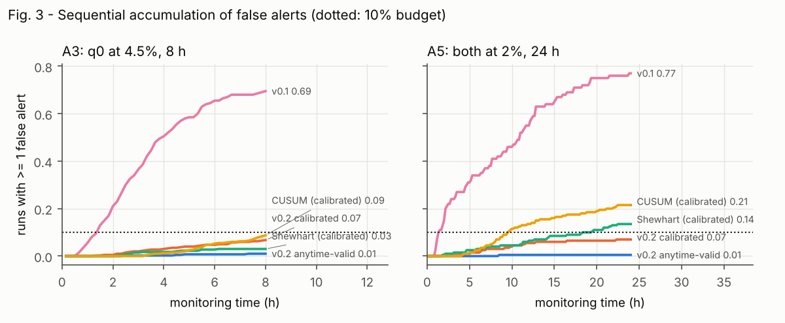
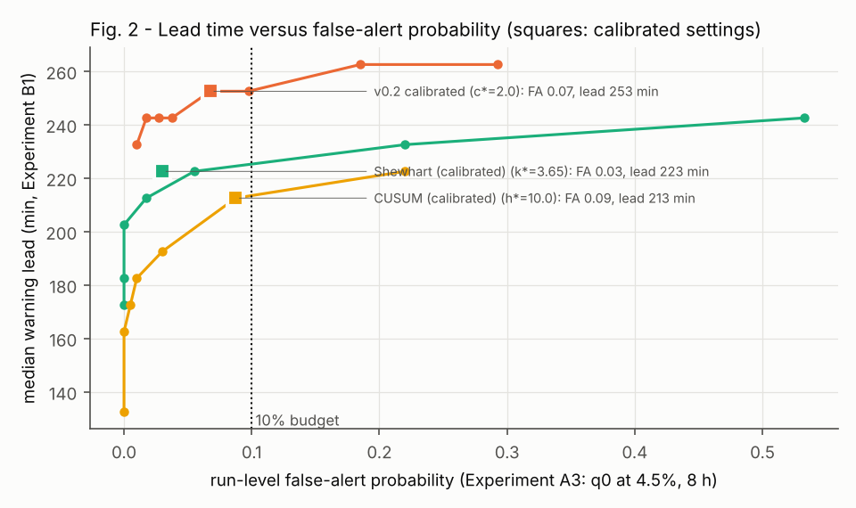
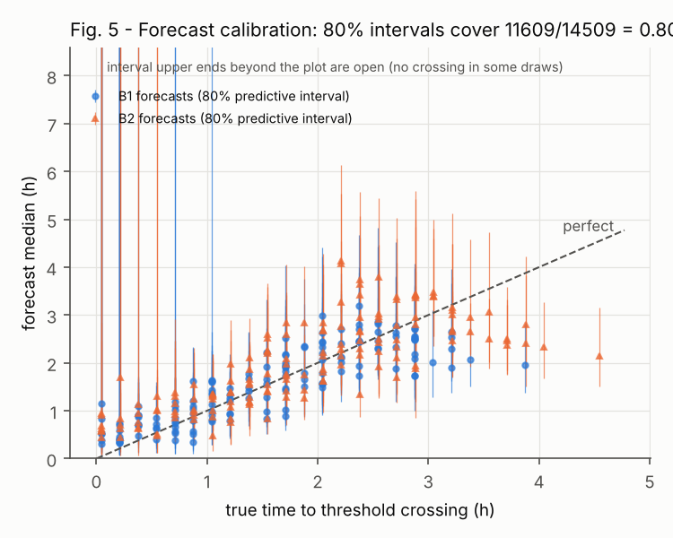
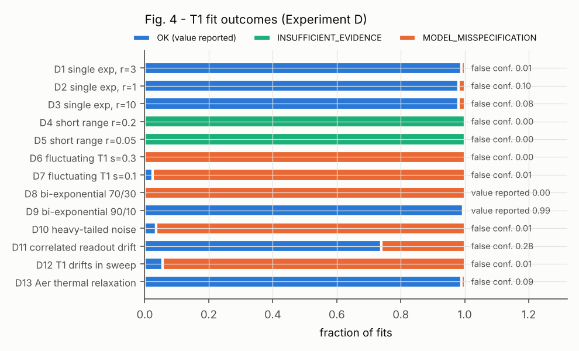
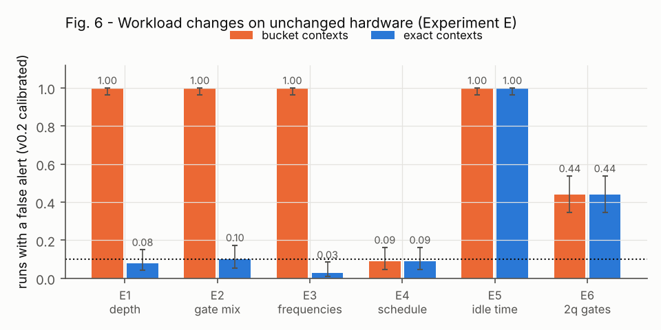
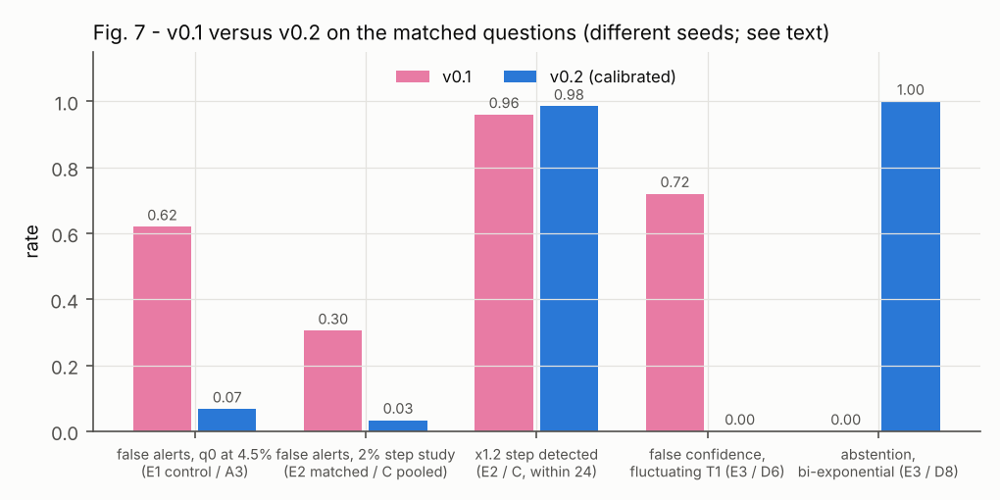
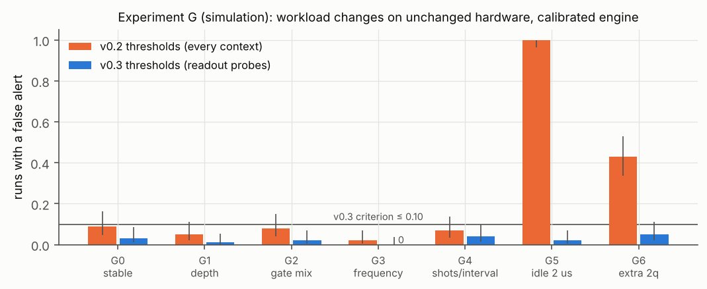
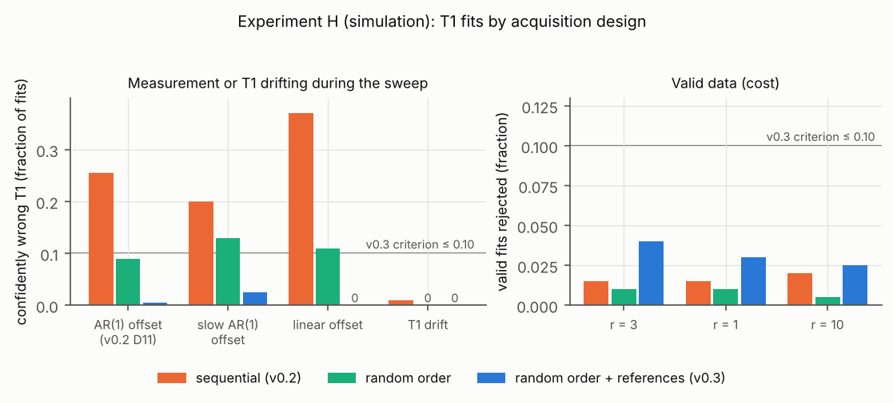

# Trustworthy warnings from continuous qubit-noise monitoring: anytime-valid alerts, abstaining forecasts and model-checked relaxation fits

*Quantum Noise Profiler v0.2 research report, with preregistered v0.3 simulation follow-up and real-device assumption check in §11.5. The pilot does not validate monitoring accuracy.*

## Abstract

A continuously re-tested noise monitor must control how often it raises false alarms over a whole session, not per check, and must refuse estimates its data cannot support. We describe Quantum Noise Profiler v0.2, which replaces per-check posterior bars with anytime-valid e-processes under an explicit session error budget, issues threshold-crossing forecasts with predictive intervals and machine-readable abstention reasons, and withholds T1/T2 values when model checks fail. In a preregistered simulation study (disjoint development, calibration and test seeds; every method on identical data), the run-level false-alert probability on stable qubits fell from 0.43–0.88 (v0.1) to at most 0.010 with anytime-valid thresholds and at most 0.070 with empirically calibrated thresholds, including 24 h sessions. At matched false-alert rates, the calibrated engine gave longer warning on gradual drift than calibrated Shewhart and CUSUM charts (253 vs 223 and 213 min) and faster detection of 20% steps, but CUSUM detected 10% steps more often. The relaxation fit refused to report a value for fluctuating T1 and two-component decays that v0.1 had fitted confidently and wrongly, but it was fooled by correlated readout drift during the sweep (28.5% false confidence). Exact circuit contexts separated most workload changes from hardware changes, but an absolute threshold on workload-dependent error rates misfired. 53 of 62 preregistered checks passed. A preregistered follow-up (v0.3, §11) moved the absolute threshold to readout probes, which removed the workload misfire, and made relaxation sweeps drift-robust (0.5% false confidence under the same drift). In a closed-loop simulation, recalibrating on warnings ran far fewer jobs on degraded qubits than fixed schedules at equal calibration cost, though a calibrated CUSUM did as well. All 40 of its simulation criteria passed. The independently preregistered pilot then ran on IBM ibm_fez (14 jobs, five qubits), where six of ten readout series rejected the constant-rate binomial null while zero of ten T1 sweeps detected within-job reference drift. These first physical-device data challenge the v0.3 drift model's null assumptions; they do not establish hardware warning accuracy or generality.

## 1. Introduction

Quantum processors are calibrated on a schedule, but their error rates and
coherence times change in between. Two-level-system defects move T1 on
minute-to-hour scales, readout fidelity drifts with amplifier and
temperature changes, and gate errors follow calibration staleness. A monitor
that watches these quantities and warns before they cross a recalibration
threshold could save failed jobs and calibration time, but only if its
warnings are reliable. A monitor that re-tests after every batch with a
fixed posterior or p-value bar alarms falsely in almost every long enough
session. A forecast extrapolated from a short or misfitted history can be
precise and wrong.

The first version of this project (v0.1) made these failure modes concrete.
In three preregistered simulation experiments it detected gradual and
abrupt degradation early, but 62% of stable sessions near threshold raised
an alert, and its T1 estimator reported confident, wrong values in 72% of
fluctuating-T1 cases and never abstained on a two-component decay. An audit
also found that its comparison against a Shewhart chart had used different
evaluation rules for the two methods.

This report describes v0.2 and tests, in a new preregistered study, whether
it fixes these problems. The contributions are:

1. a monitoring engine whose alerts come from anytime-valid e-processes
   under an explicit session error budget, with each alert labelled by the
   kind of guarantee behind it (exact, Bayesian-marginal, approximate or
   empirically calibrated);
2. forecasts that abstain with machine-readable reasons and report
   predictive intervals for the threshold-crossing time;
3. relaxation fits that refuse to report a value when the data contradict a
   single exponential or do not resolve the decay, and that say which;
4. a matched-rules re-analysis of the v0.1 benchmark; and
5. an evidence trail in which every reported number can be recomputed from
   raw data and every run is tied to the exact source it ran.

The standard applied throughout is not that the method produces more
confident answers, but that its confidence is more often deserved.

## 1.1 Related work

Sequential tests with error control at arbitrary stopping times go back to
Wald's SPRT and Ville's inequality; their modern form is the theory of
e-values, test martingales and confidence sequences (Ramdas et al. 2023;
Howard et al. 2021). Change detection with e-processes ("e-detectors") is
developed by Shin, Ramdas and Shekhar (2022). Anytime-valid inference for
linear models with unknown variance follows from Bayes factors under
right-Haar priors (Lindon and Malek 2022; Liang et al. 2008 for the
g-prior closed form). Classical statistical process control (Shewhart charts,
Page's CUSUM) controls the average run length rather than the probability
of any false alarm in a session, and its limits are usually calibrated by
simulation, which is how they are used as comparators here. For qubit
characterization, Qiskit Experiments fits T1/T2 by least squares with
heuristic quality flags; drift of superconducting-qubit parameters and TLS
fluctuations are documented in the experimental literature (e.g. Klimov et
al. 2018; Burnett et al. 2019).

## 2. Data model and identifiability

Every number the profiler emits is an *estimate* with a provenance:
**observed** (vendor calibration data), **inferred** (from ordinary workload
results) or **measured** (dedicated characterization sequences). Series are
keyed by (metric, qubits, context, provenance) and never pooled across
provenances.

From workload counts, the identifiable per-qubit quantity is the
*effective flip rate* of a qubit whose noiseless outcome is a definite bit
$b$:

$$
p_{q,c} \;=\; \Pr\big(\text{observed bit} \neq b \;\big|\; \text{qubit } q,\ \text{context } c\big),
$$

where the context $c$ summarises the qubit's noiseless path (ideal bit,
gate counts and, in *exact* mode, per-gate-name counts and idle time). It
lumps preparation, gate, decoherence and readout error and is comparable
only within one context. A batch contributes $(k, n)$ flips and shots; the
posterior under a Jeffreys prior is $\mathrm{Beta}(k + \tfrac12,\ n - k + \tfrac12)$.

T1 and T2 are not identifiable from workload counts. They are estimated from
relaxation and Hahn-echo sweeps with the model

$$
P_1(t) = A\,e^{-t/T_1} + B, \qquad k_j \sim \mathrm{Bin}\big(n_j, P_1(t_j)\big),
$$

on a grid posterior with log-uniform prior on $T_1$ and uniform priors on
the SPAM parameters $A, B$, which are marginalised.

## 3. Sequential monitoring with e-processes

A non-negative process $(E_t)$ is an **e-process** for a null $H_0$ if
$\mathbb{E}_{H_0}[E_\tau] \le 1$ for every stopping time $\tau$. By Ville's
inequality,

$$
\Pr_{H_0}\!\left(\sup_{t \ge 1} E_t \ge \tfrac{1}{\alpha}\right) \le \alpha ,
$$

for any monitoring length. This is the property a monitor re-tested after
every batch needs, and which a fixed posterior bar $\Pr(\theta \in \text{bad} \mid \text{data}) \ge 0.95$
does not have: under repeated testing, such a bar is crossed eventually with
probability approaching one.

**Change-time mixture.** For a change starting at batch $s$ the
likelihood-ratio process is $L_t(s)$ ($=1$ for $t < s$). With a geometric
prior $\pi(s) = \rho(1-\rho)^{s-1}$,

$$
E_t \;=\; \sum_{s \le t} \pi(s)\, L_t(s) \;+\; \sum_{s>t} \pi(s)
$$

is a convex combination of e-processes and hence an e-process.

**Threshold channel (exact).** For $H_0: p_u \le \theta$ for all $u$ and
alternatives $q_j = \theta(1+\varepsilon_j)$,
$L_t(s) = J^{-1}\sum_j \prod_{u=s}^{t} \mathrm{Bin}(k_u; n_u, q_j)/\mathrm{Bin}(k_u; n_u, \theta)$.
Each factor has expectation $\big[p\,q_j/\theta + (1-p)(1-q_j)/(1-\theta)\big]^{n_u} \le 1$
for $p \le \theta$, so the guarantee is frequentist and exact.

**Drift channel (Bayesian-marginal).** For $H_0$: one common unknown rate,
the null predictive is the Beta-binomial under the running Jeffreys
posterior; the alternative for a change at $s$ multiplies a rate drawn from
the null posterior *frozen at* $s-1$ by $(1+\delta)$, $\delta$ on a grid in
$[0.1, 3]$. Each term is a likelihood-ratio martingale under the Bayesian
null (rate drawn from the prior). For a fixed rate this is not a theorem;
Experiment A measures it.

**Gaussian channels.** For $y_u = a + b\,x_u + \epsilon_u$,
$\epsilon_u \sim \mathcal N(0, \sigma^2/w_u)$ with unknown $\sigma$, flat
priors on $a$ and $\log\sigma$ and a $g$-prior on $b$, the Bayes factor

$$
\mathrm{BF}_{10}(g) = (1+g)^{(\nu-1)/2}\big(1+g(1-R^2)\big)^{-\nu/2}, \qquad \nu = n-1,
$$

is a test martingale under $b = 0$ for every $(a, \sigma)$; one-sided
versions multiply by $2\Pr(\pm b>0 \mid y)$. The detectors mix
$g \in \{1, 10, 100\}$. They serve trend (forecast evidence), level-shift
(interval and point series) and curvature (lack of fit) tests.

**Family-wise budget.** The session budget $\alpha_{\text{session}} = 0.10$
is split across channels (drift 0.5, threshold 0.25, forecast 0.25) and by a
union bound across the declared qubits, metrics and provenances:
$\alpha_{\text{series}} = \alpha_{\text{session}}\cdot\text{share}/(n_q n_m n_p)$
($n_p = 1$ in every experiment reported here).
Contexts of one qubit and metric are combined by averaging e-values (an
e-value), plus a shared-change product term; time costs nothing extra.

**Meaningful deterioration.** A drift alert additionally requires
$\Pr(\text{relative change} \ge 10\% \mid \text{data}) \ge 0.5$ at the most
probable change point and at least two batches since it. These gates only
remove alerts.

**Empirical calibration.** The anytime-valid thresholds are conservative.
The *calibrated* configuration divides every threshold by $e^{c}$, with $c$
chosen on separate calibration seeds so that the maximal run-level
false-alert rate over four stable conditions is at most 0.08. It trades the
theorem for an empirical guarantee, and every alert it raises is labelled
`+calibrated`.

## 4. Forecasts and abstention

A forecast is offered only if the history has at least 6 points over at
least 1 h (else `INSUFFICIENT_HISTORY`), the one-sided trend e-value exceeds
$n_{\text{ctx}}/\alpha_{\text{forecast}}$ (else `INSUFFICIENT_EVIDENCE`), the
residuals show no structure (runs test $p \ge 0.01$) and no curvature
(quadratic-term e-value $< 20$) (else `MODEL_MISSPECIFICATION`), the slopes of
the two halves of the history agree within 3 standard errors (else
`UNSTABLE_TREND`), and the median crossing time lies within the observed span
(else `UNSUPPORTED_HORIZON`). Each rejection carries machine-readable reason
codes.

The crossing-time distribution is predictive. Draw
$\sigma^2 \sim \mathrm{InvGamma}(\nu/2, \mathrm{RSS}/2)$,
$b \mid \sigma^2 \sim \mathcal N(\hat b, \sigma^2/S_{xx})$,
$a \mid \sigma^2 \sim \mathcal N(\bar y_w, \sigma^2/\textstyle\sum w)$ and a
future process deviation $\eta \sim \mathcal N\big(0, (\sigma^2-1)_+/\bar w\big)$,
the excess of the fitted scale over the reported measurement precision.
Then $t^\ast = (\theta - a - \eta)/b$ for draws heading toward the threshold.
The report gives the 10th, 50th and 90th percentiles and
$\Pr(t^\ast \le H)$.

## 5. Model checking of relaxation fits

A fit returns a value only if every check passes:

- **Coverage of the delay range.** The delays must span at least 30% of the
  decay ($e^{-t_{\min}/\hat T_1} - e^{-t_{\max}/\hat T_1} \ge 0.3$) with at
  least three delays in $[0.1, 3]\,\hat T_1$, and the posterior must not pile
  up at the prior edge. Otherwise the status is `INSUFFICIENT_EVIDENCE`.
- **Goodness of fit.** The binomial deviance
  $D = 2\sum_j \big[k_j\log\frac{k_j}{n_j\hat p_j} + (n_j-k_j)\log\frac{n_j-k_j}{n_j(1-\hat p_j)}\big]$
  is tested against $\chi^2_{J-3}$; a posterior-predictive check compares the
  observed deviance with replicated data; a runs test examines the signs of the
  Pearson residuals along the sweep. Each test uses $\alpha = 0.01$. Failure
  gives `MODEL_MISSPECIFICATION`.
- **Diagnosis.** The marginal likelihood of a bi-exponential model is
  reported as a Bayes factor against the single exponential. It is never
  substituted for the single-exponential estimate.

## 6. Experimental design

The v0.2 study was preregistered (`experiments/V02_PREREGISTRATION.md`)
before any calibration or confirmatory run. It used disjoint seed blocks for
development, calibration and confirmation, compared every method on
identical simulated data, and recorded every run, including failures, in an
append-only log with hashes, raw data and provenance. Two clarifications
were recorded before the affected data were generated
(`results/V02_DEVIATIONS.md`).

### 6.1 Hypotheses (preregistered)

- **H1 (false-alarm control).** With anytime-valid thresholds the run-level
  false-alert probability on stable qubits is at most 0.10, with the upper
  95% bound below 0.10, for 8 h and 24 h sessions; with calibrated
  thresholds the point estimate is at most 0.10 (A.C1–C4).
- **H2 (early warning).** At matched false-alert rates the calibrated engine
  warns of gradual drift no later than 30 min after the best calibrated
  chart, and no later than v0.1 re-thresholded (B.C1–C3, B.C5).
- **H3 (forecast calibration).** 80% predictive crossing intervals cover the
  truth with frequency in [0.70, 0.90] (B.C4).
- **H4 (abrupt changes).** ×1.5 steps are detected within 6 batches and ×1.2
  within 24, non-inferior to the best chart by 0.10 (C.C1–C6). The spec claim
  for ×1.1 within 5 batches was expected to fail (C.C3).
- **H5 (model checking).** Valid fits keep ≥ 0.90 coverage with ≤ 10% loss;
  tested misspecifications give ≤ 10% false confidence; insufficient data
  and misfit are labelled correctly (D.C1–C9).
- **H6 (workload shift).** Exact contexts keep false alerts ≤ 0.10 under
  workload changes on unchanged hardware; bucketed contexts were expected to
  fail (E.C1–C2).
- **H7 (cross-framework).** Qiskit and Cirq agree on labels, contexts, rates
  and decisions (F.C1–C5).

## 7. Results

All experiments are simulations. Rates are fractions of runs, with Wilson
95% intervals in `results/V02_TABLES.md`. "Calibrated" methods were tuned on
calibration seeds (20 000–21 599) to a maximal false-alert rate of 0.08 over
four stable conditions, giving $c^\ast = 2.0$ for v0.2, $k^\ast = 3.65$ for the
Shewhart chart, $h^\ast = 10$ for CUSUM and a posterior bar of 0.998 for v0.1.
Confirmatory seeds were disjoint.

### 7.1 Sequential false-alert control (Experiment A)

| Condition | v0.1 | v0.2 anytime-valid | v0.2 calibrated | Shewhart | CUSUM |
|---|---|---|---|---|---|
| both qubits 0.5%, 8 h | 0.86 | 0.003 | 0.045 | 0.072 | 0.068 |
| both 2%, 8 h | 0.43 | 0.005 | 0.018 | 0.028 | 0.052 |
| q0 4.5%, 8 h | 0.70 | 0.010 | 0.068 | 0.030 | 0.087 |
| q0 4.9%, 8 h | 0.88 | 0.003 | 0.028 | 0.030 | 0.090 |
| both 2%, 24 h | 0.77 | 0.005 | 0.070 | 0.135 | 0.215 |

The anytime-valid engine kept the run-level false-alert rate at or below
0.010, with upper 95% bounds at or below 0.028, including the 24 h session (Fig. 3). The calibrated
engine stayed at or below 0.070. Charts calibrated on 8 h sessions exceeded
their target over 24 h, the behaviour an average-run-length calibration
predicts. All Experiment A criteria passed. Under stationary 10% log-normal
fluctuations (exploratory), every method alerted in 43–73% of runs.

### 7.2 Gradual degradation (Experiment B)

Every method alerted before the true crossing in every run except the naive
per-batch threshold (0.835 and 0.870). At matched false-alert rates the
calibrated v0.2 engine gave the longest median warning: 253 min for the
2→6% ramp, against 223 min (Shewhart), 213 min (CUSUM) and 203 min (v0.1
re-thresholded). For the 2→5.5% ramp it gave 293 min against 263, 253 and
233 min (Figs. 1–2). The 80% predictive crossing intervals contained the
true time to crossing for 0.800 of 14 509 issued forecasts
(0.794–0.807; forecasts within a run are correlated) (Fig. 5). All
Experiment B criteria passed.

### 7.3 Abrupt degradation (Experiment C)

| Step | metric | v0.1 re-thr. | v0.2 calibrated | v0.2 anytime | Shewhart | CUSUM |
|---|---|---|---|---|---|---|
| ×1.5 | within 6 batches | 1.00 | 1.00 | 1.00 | 1.00 | 1.00 |
| ×1.2 | within 6 batches | 0.20 | 0.73 | 0.46 | 0.35 | 0.48 |
| ×1.2 | within 24 batches | 0.30 | 0.985 | 0.95 | 0.685 | 0.995 |
| ×1.1 | within 5 batches | 0.015 | 0.09 | 0.025 | 0.025 | 0.08 |
| ×1.1 | within 24 batches | 0.04 | 0.515 | 0.265 | 0.155 | 0.635 |
| – | run-level false alert | 0.006 | 0.034 | 0.000 | 0.028 | 0.043 |

The calibrated engine was the fastest at moderate steps and non-inferior to
the best chart on ×1.2 within 24 batches. CUSUM was better on the smallest
step. The spec claim (×1.1 within 20 circuits, ≥ 0.80) failed for every
method (C.C3), as preregistered: it is a power limit of 4000 deterministic
shots per qubit per batch.

### 7.4 Relaxation fits under misspecification (Experiment D)

Valid single-exponential data kept calibrated intervals (coverage 0.903–0.985;
1–2% of valid fits rejected; Aer thermal relaxation 0.909). Fluctuating T1,
70/30 bi-exponential decay, heavy-tailed disturbances and drifting T1 were
rejected in 94.5–100% of fits with false confidence ≤ 0.015, against 0.72 for
v0.1 under fluctuating T1. Short delay ranges were classified as
`INSUFFICIENT_EVIDENCE` and misfit models as `MODEL_MISSPECIFICATION` in
every tested case. Two forms escaped. A mild 90/10 bi-exponential was
accepted in 99.5% of fits, and a slow correlated readout drift along the
sweep was accepted in 74% of fits, with 28.5% confidently wrong (D.C6 fails)
(Fig. 4).

### 7.5 Workload shift on unchanged hardware (Experiment E)

Exact contexts reduced false alerts after depth, gate-mix and
circuit-frequency changes from 1.00 (bucketed) to 0.03–0.10. Idle-time and
extra-two-qubit-gate changes still alerted (1.00 and 0.44) through the
absolute threshold channel, because the new circuits' effective flip rate
exceeds 5% (Fig. 6). A hardware change coinciding with a workload change was
invisible to the drift channel under exact contexts (1% of runs). Five of
six bucketed scenarios failed, as predicted; two of six exact-context
scenarios failed.

### 7.6 Cross-framework agreement (Experiment F)

Qiskit and Cirq produced identical physical qubit labels and exact contexts,
mean flip rates within 2.5 standard errors (0.1–0.6% relative), false-alert
rates of 0.05 and 0.08, and identical detection of a ×1.5 step (1.00 within
6 batches). Exact density-matrix computations agreed to $10^{-7}$. The
comparison exposed a defect in the simulation layer (two-qubit-gate
relaxation omitted in Aer when two-qubit depolarizing was zero). It did not
affect any recorded configuration and was fixed after the study.

### 7.7 v0.1 versus v0.2

Fig. 7 sets v0.1 and v0.2 side by side on the questions both studies
asked. The studies used different seeds and, for the step-detection bar, v0.1 at
its own (much higher) false-alert rate; matched-rate comparisons are in
§7.2–7.3.

## 8. Discussion

**What the evidence supports.** In simulation, the anytime-valid design does
what its theory says: the false-alert probability over a whole session stays
below budget independently of session length. An empirical calibration of
the same statistics buys back sensitivity and still holds the rate under
10% on fresh seeds, while losing the length-independence. Against
calibrated control charts, the e-process engine is competitive: it is better
for gradual drift and moderate steps, and worse than CUSUM for the smallest
step. The model checks turn the most damaging v0.1 failure — confident
wrong T1 values — into explicit refusals for the misspecifications that
leave a visible signature, and they distinguish "not enough data" from
"wrong model".

**What it does not support.** None of this is evidence about real devices.
The two misspecifications that escaped (mild bi-exponential, correlated
readout drift) are plausible on hardware, and a model check with 15 sweep
points has little power against smooth departures. The workload experiment
showed that the
monitoring architecture is only as good as its definition of comparable
series: exact contexts fix most workload shifts, but an absolute threshold
on a workload-dependent rate is a category error that the study exposed and
v0.2 does not fix.

## 9. Limitations of the v0.2 simulation study (historical)

1. **Simulation only.** No real-device data; batch independence, binomial
   per-context counts and the absence of within-job drift are assumptions.
2. **Thresholds on workload-dependent quantities** produce false CRITICAL
   alerts when the workload changes (E5, E6). A fix — thresholds tied to a
   fixed probe context or relative to each context's baseline — is not
   implemented or tested. *(v0.3: probe thresholds implemented and tested in
   simulation, §11.2.)*
3. **Stationary fluctuations** at the effect-gate scale (10%) alarm in about
   half of sessions; a deployment needs a fluctuation model from device data.
4. **Correlated measurement drift during sweeps** defeats the misfit checks
   (D11); randomised delay order or interleaved references are untested
   remedies. *(v0.3: both implemented and tested in simulation, §11.3.)*
5. **Detection of small changes is slow** (10–15 batches for 10% at 4000
   shots per qubit per batch); the spec claim of 20 circuits is not met.
6. **The drift channel's guarantee is Bayesian-marginal**; its frequentist
   behaviour at fixed rates is established empirically for the tested rates
   only. The calibrated configuration has an empirical guarantee only.
7. **Union-bound budgeting** across qubits and metrics becomes conservative
   for large families; tested families were 2 qubits × 1 metric.
8. **One computing environment** for the full study; cross-machine
   bit-identity is unverified.
9. **Vendor calibration values are not ground truth**; a hardware study
   without an independent reference can test consistency, not accuracy.

## 10. Reproducibility and data availability

All code, raw data and the analysis that produced every number are in this
repository. `python tools/verify_results.py` recomputes every reported
summary from the raw files and checks their SHA-256 hashes;
`python tools/check_provenance.py` checks that each run used a clean,
unchanged source tree and seeds from its preregistered block. Figures are
regenerated by `python tools/make_figures.py` (Figs. 1–7) and
`python tools/make_v03_figures.py` (Figs. 8–10). See `docs/REPRODUCIBILITY.md`.

## 11. v0.3 follow-up (preregistered)

A second preregistered study (`experiments/V03_PREREGISTRATION.md`, committed
and pushed before any confirmatory run) addressed limitations 1, 2 and 4 of
§9 and asked whether earlier warnings have operational value. Three
simulation experiments ran unchanged from the protocol: G (thresholds), H
(decay fits) and I (operational value). 40 of 40 criteria passed. A hardware
pilot (P) subsequently ran once on IBM ibm_fez and challenged the constant-rate readout null (§11.5). Details and every
criterion: `results/V03_SUMMARY.md`, `results/V03_TABLES.md`.

### 11.1 What changed

- **Readout probes carry the absolute threshold.** Prepare-and-measure
  circuits become MEASURED `readout_error` series; workload effective flip
  rates keep relative drift monitoring only (§11.2).
- **Drift-robust decay sweeps.** Delays are acquired in random order with
  interleaved ground references, whose homogeneity is tested (§11.3).
- **Hardware path.** Sweep delays are rounded to the backend's timing grid,
  vendor values keep their per-property calibration timestamps, and a pilot
  runner submits nothing without an explicit flag and a cumulative budget
  (§11.5).

### 11.2 Thresholds on workload-independent series (Experiment G)

The identifiable workload quantity, the effective flip rate $p_{q,c}$, depends
on the circuit context $c$; an absolute threshold on it tests the workload as
much as the hardware. v0.3 applies the absolute threshold only to *readout
probes*: circuits that prepare each measured qubit in a basis state (nothing
or one X gate) and read it out immediately, recognised by that structure in
Qiskit and Cirq results. Their flip rate is the assignment error
$\Pr(\text{read } 1-b \mid \text{prepared } b)$, reported as MEASURED
`readout_error` with contexts `p(1|0)`, `p(0|1)` (the vendor's
`prob_meas1_prep0`, `prob_meas0_prep1`). Counts stay binomial, so the
threshold e-process keeps its exact guarantee (§3). Workload effective flip
rates keep the drift channel (relative change) but get no absolute threshold
and no crossing forecast. Monitoring both doubles the declared family
($n_m = 2$), halving every per-series α.

On the Experiment E device with two probe circuits per batch (100 runs per
scenario), the v0.2 failure reproduced: thresholds on every context raised
false alerts in 100% of runs after a 2 µs idle was added before measurement
and in 43% after extra two-qubit gates. With the v0.3 thresholds these were
2% and 5% (Fig. 8), and the threshold channel raised no false alert in any
of 700 runs on unchanged hardware; the remaining 0–5% came from the drift
channel.

A readout increase coinciding with a workload change was detected by the q0
probes within six batches in every run (first alert after a median of one
batch). In v0.2 Experiment E, which had no probes, the drift channel had
caught it in 1% of runs. Here the v0.2 architecture detected it too, through
the same probe circuits treated as effective-flip contexts, so a fixed probe
context, not the threshold's placement, is what fixes this case. On a
readout ramp, every run warned before the crossing, 10 minutes later in the
median than the v0.2 architecture on the same data (242.5 vs 252.5 min). All
12 criteria passed.

### 11.3 Decay fits under measurement drift (Experiment H)

The v0.2 checks examine residuals along the delay axis. When delays are
acquired in delay order, a slow drift of the measurement is a smooth function
of delay, and the fit absorbs it into the amplitude, offset and T1. The v0.3
design acquires the delays in random order and interleaves five ground
references (prepare |0⟩, measure) at evenly spaced acquisition positions.
Their outcome probability does not depend on T1, so a likelihood-ratio test
of their homogeneity ($G = 2\sum_r [k_r\log\frac{k_r}{n_r\hat p} + (n_r-k_r)\log\frac{n_r-k_r}{n_r(1-\hat p)}]$
against $\chi^2_{K-1}$, α = 0.01) measures drift directly. A significant
result reports `READOUT_DRIFT` and the fit is `MODEL_MISSPECIFICATION`. The
references never enter the fit.

With drift defined along the acquisition, the sequential design reproduced
the v0.2 failure (D11 conditions: 0.255 confidently wrong), and a linear
offset drift of ±1.5% was worse (0.370). Randomizing the order alone reduced
these to 0.090 and 0.110 but left slow drift at 0.130. With references, the
rates were 0.005, 0.025 (slow AR(1)) and 0.000 (linear) (Fig. 9). The price was
2.5–4% of valid fits rejected (1.5–2% with the sequential design) and five
extra circuits per 15-delay sweep. Coverage of valid fits, which the design
does not change, was 0.917 pooled over r = 1, 3, 10 (0.90–0.93 per range); at
r = 1 and r = 10 it sits near 0.90 in every design, as in v0.2. All 19
criteria passed.

### 11.4 Do earlier warnings reduce failed jobs or calibration overhead? (Experiment I)

Experiment I simulates the operator's decision directly. Two qubits degrade
through random gradual onsets and abrupt jumps (illustrative rates, five
scenarios), on top of a stationary ±5% fluctuation of the readout error. A
calibration costs one 10-minute batch of downtime and resets the qubit. A
job fails if it runs while its qubit's true readout error exceeds 5%. Fixed
calibration schedules, from every 48 h to every 2 h, define a frontier of
failed jobs against calibrations per qubit-day (Fig. 10). Monitoring policies
recalibrate on the v0.3 engine's alerts on readout probes, with or without a
daily schedule. All policies see the same degradation events.

With the daily schedule alone, 13–20% of jobs failed in the three scenarios
with about one degradation event per qubit-day. Recalibrating on any v0.3
warning as well cut this to 0–0.31%, 4.7–5.4 percentage points below the
frontier at the same calibration rate (1.8 points with rare degradation). Without
the schedule, warnings alone failed 0–0.25% of jobs at 0.8–1.3 calibrations
per qubit-day; in I2–I4 no fixed schedule up to every 2 h (11.75 per
qubit-day) failed as few. Against the daily schedule itself, however,
warnings alone saved calibrations only when degradation was rare (−0.27 per
qubit-day) or absent (0.20 against 0.75). With daily degradation they cost
the same or about 0.5 more. Early warnings mattered: acting on drift
warnings, not only on crossings and forecasts, removed a further 0.8–3.2
points of failed jobs for 0.6–1.0 more calibrations per qubit-day.

Three results limit the claim. A calibrated CUSUM on the same probes
performed as well: failed-job differences were at most 0.16 points, and the
engine used 0.07–0.09 more calibrations per qubit-day in three of ten
comparisons. The gain therefore comes from monitoring probes and acting
early, not from the e-process. Second, 0.27–0.44 calibrations per qubit-day
were triggered while the qubit was neither above threshold nor degraded by
10%, the stationary-fluctuation problem of §9 item 3. Third, probe shots
were not counted as a cost. All 9 criteria passed.

### 11.5 Physical-QPU pilot (Experiment P): P.C1 fails; P.C2 passes

Experiment P, fixed in `experiments/V03_PREREGISTRATION.md` before execution, ran on IBM `ibm_fez` on 2026-10-13/14 UTC using **qubits 54, 108, 127, 59 and 87**. The 14 jobs produced 296,000 shots over approximately two hours, at 130 seconds of reported QPU usage. The unchanged experiment collected a T1 sweep, 12 prepare-and-measure probe batches 10 minutes apart, and a second T1 sweep. The resource cap was 320,000 shots and 420 seconds estimated QPU time. Two previous attempts on `ibm_kingston` were interrupted and **excluded** (see `results/V03_DEVIATIONS.md`). The recorded complete run is `V03_P_pilot-20261013T234830-220ff3` (clean source commit `1ea9556`).

Two prospectively fixed model checks gave different answers:

1. **P.C1 fails: constant-rate binomial readout is inadequate over this session.** Of 5 qubits × 2 preparations, **6 of 10** series rejected a constant error rate across 12 batches at α = 0.01, exceeding the prespecified allowance of ≤ 1. The rejecting series had G/degrees-of-freedom between 2.3 and 12.6. For qubit 108, `p(0|1)` increased from approximately 1.0% to 2.98% and then partially recovered. The binomial constant-rate null therefore does not describe all the measured series. The test does not distinguish physical drift, temporal dependence or unmodeled experimental variation.
2. **P.C2 passes: no within-job reference drift detected in these sweeps.** Zero of ten T1 sweeps rejected ground-reference homogeneity (allowance ≤ 1, α = 0.01). This is a non-rejection with limited power, not proof that readout is stationary.

Seven of ten T1 fits passed the model checks; three abstained for insufficient evidence or misspecification. Among accepted estimates, qubit 87 changed from 167 µs [150, 189] to 94 µs [88, 101] between sweeps. The v0.3 drift engine emitted five warnings on qubit 108 after the probe excursion. **No independent hardware deterioration reference was measured**, so neither their correctness nor detector false-positive/true-positive performance can be inferred. Vendor calibration values are not ground truth.

The complete numerical results, per-series probe rates, raw counts, timestamps, calibration snapshots and limitations are in [the hardware addendum](../docs/report/HARDWARE_ADDENDUM.md), `results/V03_SUMMARY.md` and `results/runs.jsonl`. The original simulation-only 10-page PDF is retained as a dated historical snapshot, not silently rewritten.

### 11.6 Limitations after v0.3

Items 2 and 4 of §9 are addressed **in simulation**. The physical-QPU
pilot now directly challenges the constant-rate assumption from §9 item 1:
6 of 10 probe series reject a fixed binomial rate across jobs. Within-job
drift was not detected in the limited P.C2 sweeps. Stationary fluctuations
(item 3) have a simulated operational cost and now a real-device motivation,
but the actual hardware false-alert rate is **unknown**. Items 5–9 remain
limitations. Additional constraints:

- The operational result depends on illustrative degradation rates.
- It assumes the user can recalibrate, which cloud users cannot; for them
  the intervention is avoiding or remapping a degraded qubit, which has not
  been tested.
- Readout probes cost shots in every monitored job.
- No second backend, multi-day replication, or independently labeled
  deterioration event was tested; the five drift warnings cannot be scored.
- A constant-rate null is an unsafe assumption for this device's observed
  between-batch variation, and the v0.3 drift-channel's guarantee cannot
  simply be transferred to this different data-generating process.

### 11.7 Planned independent follow-up (not run)

The exploratory variance and lag-correlation diagnostics of the existing
pilot may be reproduced with `python tools/pilot_diagnostics.py`. They are
**not** an independent experiment. A new hardware validation, including
held-out sessions, fixed robust-model and CUSUM baselines, session-level
error accounting, independent labels when feasible, and QPU cost, is
proposed in `experiments/P04_FOLLOWUP_PLAN.md`. No P04 data have been
collected.

## References

- Burnett, J. J. et al. (2019). Decoherence benchmarking of superconducting qubits. *npj Quantum Information* 5, 54.
- Howard, S. R., Ramdas, A., McAuliffe, J., Sekhon, J. (2021). Time-uniform, nonparametric, nonasymptotic confidence sequences. *Annals of Statistics* 49(2), 1055–1080.
- Klimov, P. V. et al. (2018). Fluctuations of energy-relaxation times in superconducting qubits. *Physical Review Letters* 121, 090502.
- Liang, F., Paulo, R., Molina, G., Clyde, M. A., Berger, J. O. (2008). Mixtures of g priors for Bayesian variable selection. *Journal of the American Statistical Association* 103(481), 410–423.
- Lindon, M., Malek, A. (2022). Anytime-valid linear models and regression adjusted causal inference in randomized experiments. arXiv:2210.08589.
- Page, E. S. (1954). Continuous inspection schemes. *Biometrika* 41(1/2), 100–115.
- Ramdas, A., Grünwald, P., Vovk, V., Shafer, G. (2023). Game-theoretic statistics and safe anytime-valid inference. *Statistical Science* 38(4), 576–601.
- Shin, J., Ramdas, A., Shekhar, S. (2022). E-detectors: a nonparametric framework for sequential change detection. arXiv:2203.03532.
- Ville, J. (1939). *Étude critique de la notion de collectif.* Gauthier-Villars.
- Wald, A. (1945). Sequential tests of statistical hypotheses. *Annals of Mathematical Statistics* 16(2), 117–186.
- Software: Qiskit, Qiskit Aer, Qiskit Experiments, Qiskit IBM Runtime (Qiskit contributors); Cirq (Cirq Developers); Stim (Gidney 2021, *Quantum* 5, 497).
